  
    
  
  
  
  

 

Hi, I'm **T13o** (short for TheInfamousToTo), an infrastructure engineer and developer who enjoys turning everyday IT problems into useful, self-hosted tools. After hours I run a homelab that has grown into a small datacenter, and most of what I build starts as "I wish this existed for my lab" and ends up as an open-source Docker image.

- 🛠️ **I build:** self-hosted applications, infrastructure utilities and automation tools
- ☸️ **Core tools:** Kubernetes (Talos), Docker, Proxmox, TrueNAS, Python, Go, TypeScript, React and PostgreSQL
- 🤖 **Local AI:** self-hosted LLMs and image generation on my own GPU node
- 🤝 **Open source:** maintaining my projects and sending fixes upstream
- 💬 **Ask me about:** homelabs, deployment workflows, observability and practical IT automation
- 🎮 **Beyond IT:** gaming, streaming, Raspberry Pi projects and community tools

---

## 🛒 Shop

Tech work built by one person and run on my own servers, available at **[shop.satrawi.com](https://shop.satrawi.com)**:

- 🎥 **Stream overlays (T13o)**, with a free demo
- 🤖 **Discord bots**, automation and integrations
- 🏋️ **Gym App** and 🍽️ **Meal App**, plus other hosted apps
- 🖥️ **Managed IT & infrastructure** and custom software development

---

## 🏠 The Lab

| Layer | What runs there |
| --- | --- |
| **Compute** | Proxmox VE cluster with LXC containers and VMs |
| **Storage** | TrueNAS SCALE backing Kubernetes persistent volumes |
| **Orchestration** | Talos Linux Kubernetes run with GitOps, Rancher, plus Docker hosts via Portainer |
| **Data & identity** | CloudNativePG databases, Authentik SSO |
| **Edge** | Traefik reverse proxy, Cloudflare, WireGuard / Tailscale |
| **Observability** | Prometheus, Loki and Grafana |
| **AI** | GPU node with Ollama, Open WebUI and ComfyUI |
| **Automation** | n8n workflows, Discord bots, Home Assistant with Zigbee and ESP32 sensors |
| **Security** | Wazuh SIEM, Pi-hole, automated image updates |

---

## 🔥 Current Focus

- **Homelab:** everything on the Talos cluster defined as code, one manifest and runbook per app.
- **PiHoleVault:** multi-instance Pi-hole backup and restore, encrypted off-site backups, backup verification and testing.
- **Gold Tracker:** self-hosted gold/silver portfolio tracking plus stocks and ETFs with broker-aware trading fees.
- **Wazuh Vulnerability Explorer:** turning large volumes of vulnerability findings into actionable, fleet-level views.
- **Stream kit:** an OBS overlay package with themes, a PNGtuber avatar, alerts and in-OBS control panels.
- **DevOps & security:** Docker deployments, CI/CD, observability and upstream dependency/security fixes.

---

## 💻 Tech Stack

<b>Show / hide</b>

### 🖥️ Languages

### 🌐 Frameworks & Libraries

### 🗄️ Databases

### ☁️ DevOps & Cloud Native

### 🖥️ OS, Virtualization & Homelab

### 📈 Observability

### 🌐 Networking, Security & IoT

### 🤖 AI & Automation

---

## 📊 GitHub Analytics

  
  

 

  

---

## 🚀 Featured Projects

### ⭐ Established Projects

| Project | What it does | Stack | Highlights |
| --- | --- | --- | --- |
| [**PiHoleVault**](https://github.com/TheInfamousToTo/PiHoleVault) | Self-hosted Pi-hole v6 backup and restore manager | JavaScript, React, Docker |  · Multi-instance support · Selective restore · Encrypted off-site backups · v2.1.1 |
| [**plex-suggester**](https://github.com/TheInfamousToTo/plex-suggester) | Find something to watch in Plex, solo or with friends | Python, Flask, Docker |  · Swipe-to-match · Shared rooms · Watchlist integration |
| [**hub-helper**](https://github.com/TheInfamousToTo/hub-helper) | Manage GitHub and Docker Hub project deployments from a web UI | Python, Flask, Docker |  · OAuth · Version tagging · Global deployment analytics |

### 🆕 Newer Projects

| Project | What it does | Stack | Highlights |
| --- | --- | --- | --- |
| [**gold-tracker**](https://github.com/TheInfamousToTo/gold-tracker) | Self-hosted portfolio tracker for precious metals, stocks, and ETFs | Go, React, PostgreSQL, Docker | Spot-price history · P/L tracking · Broker fee schedules · FX accounting |
| [**Wazuh-Vulnerability-Explorer**](https://github.com/TheInfamousToTo/Wazuh-Vulnerability-Explorer) | Security dashboard for prioritizing Wazuh vulnerability findings across a fleet | Python, Wazuh, OpenSearch | CVE grouping · Fleet reach · Historical trends · Authenticated access |

### 🔧 Automation & Utilities

| Project | What it does | Stack | Highlights |
| --- | --- | --- | --- |
| [**N8N-Approval-Service**](https://github.com/TheInfamousToTo/N8N-Approval-Service) | Human-in-the-loop approval before n8n workflows publish content | TypeScript, React, PostgreSQL | Discord approval buttons · Post dashboard · Callback API |
| [**hoyolab-code-notifier**](https://github.com/TheInfamousToTo/hoyolab-code-notifier) | Monitor HoYoLab redemption codes and notify Discord | Python, Docker | Genshin Impact · Honkai: Star Rail · Zenless Zone Zero · Multi-webhook rules |
| [**file-organizer**](https://github.com/TheInfamousToTo/file-organizer) | Organize desktop files into categories | Python, Windows Batch | Dry-run previews · Automated sorting · File statistics |

### 🖥️ Hardware & IoT

| Project | What it does | Stack | Highlights |
| --- | --- | --- | --- |
| [**PI-HAT-Screen**](https://github.com/TheInfamousToTo/PI-HAT-Screen) | OLED system information display for Raspberry Pi | Python, Raspberry Pi | System metrics · Animated display · Burn-in prevention |

### 📚 Academic & Learning

| Project | Description | Language |
| --- | --- | --- |
| [**M251**](https://github.com/TheInfamousToTo/M251) | Course coding projects and mock exams | Java |
| [**M109**](https://github.com/TheInfamousToTo/M109) | Class materials and exercises | C# |
| [**TM112**](https://github.com/TheInfamousToTo/TM112) | Class materials and exercises | Python |

---

## 🤝 Open Source Contributions

I actively track and improve open-source repositories in the infrastructure and home lab space. Here are some key projects I've contributed to:

| 🚩 Repository | 📝 My Contribution |
| ------- | ----------- |
| [**Dictionarry-Hub/profilarr**](https://github.com/Dictionarry-Hub/profilarr) | Fixed CI/CD GitHub Actions image pushing for `ghcr.io` deployments |
| [**Zggis/plex-tvtime**](https://github.com/Zggis/plex-tvtime) | Implemented Discord notifications for application startup and user login events |
| [**torikushiii/hoyolab-auto**](https://github.com/torikushiii/hoyolab-auto) | Added comprehensive file logging functionality and improved Docker containerization configuration |
| [**roslovets/SP110E-HASS**](https://github.com/roslovets/SP110E-HASS) | Integrated and populated support/funding configurations |
| [**invoicerr-app/invoicerr**](https://github.com/invoicerr-app/invoicerr) | Merged security dependency fixes for authentication and documentation ([#841](https://github.com/invoicerr-app/invoicerr/pull/841), [#921](https://github.com/invoicerr-app/invoicerr/pull/921)) |
| [**harry0703/MoneyPrinterTurbo**](https://github.com/harry0703/MoneyPrinterTurbo) | Merged remediation of fixable Trivy high/critical findings in the CPU image ([#1729](https://github.com/harry0703/MoneyPrinterTurbo/pull/1729)) |

---

## 💰 Support

If you like my work, consider buying me a coffee or supporting me on Ko-fi! ☕

---